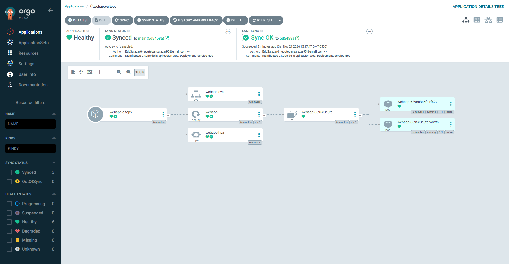
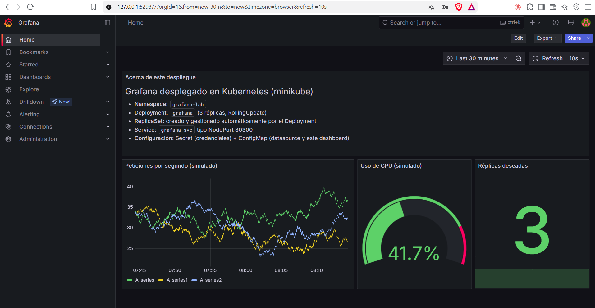

# Kubernetes: Grafana con Deployment/ReplicaSet y GitOps con Argo CD

Repositorio de los talleres de Kubernetes sobre un clúster local de **minikube** (perfil `taller`).

| Taller | Contenido | Informe |
|---|---|---|
| **2. GitOps con Argo CD** | Aplicación web con Deployment, Service NodePort y HPA, desplegada y sincronizada automáticamente por Argo CD desde este repositorio | [PDF](Informe_Tarea_ArgoCD_GitOps.pdf) · [Word](Informe_Tarea_ArgoCD_GitOps.docx) |
| **1. Grafana con Deployment y ReplicaSet** | Grafana con 3 réplicas, Service NodePort, autorreparación, escalado, rolling update y rollback | [PDF](Informe_Tarea_K8s_Grafana.pdf) · [Word](Informe_Tarea_K8s_Grafana.docx) |

## Estructura del repositorio

```
.
├── gitops/
│   └── webapp/                      # Ruta que sincroniza Argo CD (fuente de verdad)
│       ├── deployment.yml           # Deployment: 2 réplicas, requests/limits, puerto 80
│       ├── service.yml              # Service NodePort 30080
│       └── hpa.yml                  # HPA: 2 a 5 réplicas, objetivo CPU 50 %
├── argocd/
│   ├── application.yml              # Application de Argo CD con Automated Sync
│   └── load-generator.yml           # Generador de carga para probar el HPA (fuera de GitOps)
├── grafana/                         # Taller 1: manifiestos de Grafana
│   ├── 00-namespace.yml ... 04-grafana-service.yml
│   └── 05-replicaset-demo.yml
├── pod_gnix/
│   └── first_pod_nginx.yml          # Pod de nginx visto en clase (punto de partida)
├── evidencias/
│   ├── argocd/                      # Taller 2: salidas reales de kubectl de cada prueba
│   ├── capturas/                    # Capturas de ambos talleres (01-11 taller 1, 12-33 taller 2)
│   └── 01-*.txt ... 07-*.txt        # Taller 1: salidas reales de kubectl
├── Informe_Tarea_ArgoCD_GitOps.docx / .pdf
└── Informe_Tarea_K8s_Grafana.docx / .pdf
```

---

# Taller 2: Despliegue de una aplicación con Argo CD y Kubernetes (GitOps)

Se despliega una aplicación web (`nginxdemos/hello`, un nginx que muestra qué Pod atendió cada petición) usando **este repositorio como fuente de verdad**. Argo CD vigila la carpeta [`gitops/webapp`](gitops/webapp) de la rama `main` y sincroniza automáticamente el clúster con cada commit.



| Elemento | Valor |
|---|---|
| Clúster | minikube `taller` (driver Docker, Kubernetes v1.37.0) |
| Argo CD | v3.6.2 (namespace `argocd`) |
| Metrics Server | v0.9.0 (addon de minikube) |
| Application | `webapp-gitops`, ruta `gitops/webapp`, rama `main`, Automated Sync (`prune` + `selfHeal`) |
| Namespace de la app | `webapp-gitops` |
| Deployment | `webapp`, 2 réplicas iniciales, requests `50m`/`32Mi`, limits `200m`/`64Mi`, puerto `80` |
| Service | `webapp-svc`, NodePort `30080` (`port: 80` → `targetPort: http`) |
| HPA | `webapp-hpa`, 2 a 5 réplicas, objetivo 50 % de CPU |

## Flujo GitOps

```
Desarrollador ── git push ──▶ GitHub (rama main, gitops/webapp)
                                     ▲
                                     │ Argo CD consulta el repositorio (cada 3 min)
Clúster ─ argocd: Application webapp-gitops ── compara Git vs clúster y sincroniza
        └ webapp-gitops: Deployment ─▶ ReplicaSet ─▶ Pods (2-5) ◀─ HPA ◀─ Metrics Server
                         Service NodePort 30080 ─▶ Pods con app=webapp
```

**Decisión de diseño (Argo CD + HPA):** el HPA cambia `spec.replicas` del Deployment (por ejemplo a 5), pero Git declara `replicas: 2`. Con `selfHeal`, Argo CD devolvería el Deployment a 2 réplicas y pelearía con el HPA. Por eso [`argocd/application.yml`](argocd/application.yml) declara `ignoreDifferences` sobre `/spec/replicas` y la opción `RespectIgnoreDifferences=true`: Git define las réplicas **iniciales** y después el HPA es el dueño de ese campo.

## Cómo ejecutar el taller 2

Requisitos: los mismos del taller 1 (Docker Desktop encendido, minikube, kubectl y Git), unos 3 GB de RAM libres y conexión a internet. Los comandos se ejecutan dentro de la carpeta del repositorio clonado:

```bash
git clone https://github.com/EduSalazar0/k8s-grafana-deployment-replicaset.git
```

```bash
cd k8s-grafana-deployment-replicaset
```

### 1. Clúster y Metrics Server

```bash
minikube start -p taller --driver=docker
```

```bash
minikube addons enable metrics-server -p taller
```

```bash
kubectl top nodes
```

### 2. Instalar Argo CD

```bash
kubectl create namespace argocd
```

```bash
kubectl apply -n argocd --server-side --force-conflicts -f https://raw.githubusercontent.com/argoproj/argo-cd/stable/manifests/install.yaml
```

```bash
kubectl -n argocd wait --for=condition=Ready pods --all --timeout=300s
```

`--server-side` es necesario porque el CRD de ApplicationSet es demasiado grande para el `kubectl apply` clásico.

### 3. Crear la aplicación en Argo CD (una sola vez)

```bash
kubectl apply -f argocd/application.yml
```

```bash
kubectl -n argocd get applications.argoproj.io
```

En 1–2 minutos debe aparecer `webapp-gitops   Synced   Healthy`. Al inicio puede verse `Degraded` unos segundos mientras el HPA recibe las primeras métricas.

### 4. Abrir la consola de Argo CD

Contraseña inicial del usuario `admin` (PowerShell):

```powershell
[Text.Encoding]::UTF8.GetString([Convert]::FromBase64String((kubectl -n argocd get secret argocd-initial-admin-secret -o jsonpath="{.data.password}")))
```

```bash
kubectl port-forward svc/argocd-server -n argocd 8080:443
```

Abrir `https://localhost:8080` (aceptar el certificado autofirmado) e ingresar con `admin`. La terminal del port-forward debe quedar abierta.

### 5. Abrir la aplicación web

```bash
minikube service webapp-svc -n webapp-gitops -p taller
```

La página muestra el nombre del Pod que respondió; al recargar cambia entre réplicas. En Windows/macOS la terminal debe quedar abierta (túnel de minikube).

### 6. Probar el HPA

```bash
kubectl apply -f argocd/load-generator.yml
```

```bash
kubectl -n webapp-gitops get hpa webapp-hpa -w
```

Si no llega a 5 réplicas, aumentar la carga:

```bash
kubectl -n webapp-gitops scale deploy load-generator --replicas=8
```

Para retirar la carga (el HPA vuelve a 2 réplicas en 1–2 minutos):

```bash
kubectl delete -f argocd/load-generator.yml
```

### 7. Probar la sincronización automática

Cambiar algo en `gitops/webapp` (por ejemplo la versión de la imagen en `deployment.yml`), hacer commit y push a `main`. Sin tocar el clúster, en un máximo de 3 minutos Argo CD aplica el cambio:

```bash
kubectl -n argocd get applications.argoproj.io webapp-gitops -o wide
```

```bash
kubectl -n webapp-gitops get rs -o wide
```

### 8. Probar el self-heal

Un cambio manual se revierte solo en segundos:

```bash
kubectl -n webapp-gitops delete svc webapp-svc
```

```bash
kubectl -n webapp-gitops get svc webapp-svc
```

## Pruebas realizadas (taller 2)

Las salidas completas están en [`evidencias/argocd/`](evidencias/argocd/) y las capturas en [`evidencias/capturas/`](evidencias/capturas/) (12 a 33).

| # | Prueba | Resultado | Evidencia |
|---|---|---|---|
| 1 | Metrics Server | `kubectl top` devuelve CPU y memoria | [12](evidencias/argocd/12-metrics-server.txt) |
| 2 | Instalación de Argo CD | 7 Pods `Running`, v3.6.2 | [13](evidencias/argocd/13-argocd-instalacion.txt) |
| 3 | Application con Automated Sync | `Synced`/`Healthy` en el commit `5d5458a`, sin `kubectl apply` de los manifiestos | [14](evidencias/argocd/14-argocd-application.txt), capturas 17–21 |
| 4 | Recursos y etiquetas | Deployment 2/2, Service `80:30080`, HPA `2%/50%`, EndpointSlice con las 2 IPs | [15](evidencias/argocd/15-recursos-webapp.txt) |
| 5 | Acceso | HTTP 200 y balanceo entre los 2 Pods | [16](evidencias/argocd/16-acceso-webapp.txt), captura 22 |
| 6 | HPA escala | CPU 70 % → 2 → 3 → 4 → 5 réplicas | [23](evidencias/argocd/23-hpa-generador-carga.txt), [24](evidencias/argocd/24-hpa-escalado-maximo.txt) |
| 7 | HPA y Argo CD conviven | 5 réplicas en el clúster, 2 en Git, app `Synced` | [25](evidencias/argocd/25-hpa-5-replicas-argocd-synced.txt), captura 26 |
| 8 | HPA reduce | Sin carga vuelve a 2 réplicas | [27](evidencias/argocd/27-hpa-reduccion.txt) |
| 9 | Cambio en Git | Commit `7b3d371` (imagen 0.3 → 0.4) detectado y sincronizado solo en 2 min 23 s | [28](evidencias/argocd/28-gitops-commit-push.txt), [29](evidencias/argocd/29-gitops-sync-automatico.txt), capturas 30–32 |
| 10 | Self-heal | Service borrado e imagen cambiada a mano: Argo CD lo revierte en ~1 s | [33](evidencias/argocd/33-argocd-self-heal.txt) |

## Limpieza del taller 2

```bash
kubectl delete -f argocd/application.yml
```

```bash
kubectl delete namespace argocd
```

---

# Taller 1: Grafana en Kubernetes con Deployment y ReplicaSet

Tarea individual. Se despliega **Grafana** (plataforma de visualización y monitoreo) en un clúster local de **minikube**, aplicando los conceptos de **Deployment** y **ReplicaSet**, y se expone fuera del clúster con un **Service NodePort**.

| Elemento | Valor |
|---|---|
| Clúster | minikube, perfil `taller` (driver Docker, Kubernetes v1.37.0) |
| Namespace | `grafana-lab` |
| Imagen | `grafana/grafana:11.6.0` (actualización de prueba a `12.0.0`) |
| Réplicas | 3 |
| Exposición | Service `grafana-svc`, NodePort `30300` |
| Credenciales de laboratorio | usuario `admin` / clave definida en [`01-grafana-secret.yml`](grafana/01-grafana-secret.yml) |

El informe técnico del taller 1, con capturas y análisis de cada paso, está en [Informe_Tarea_K8s_Grafana.pdf](Informe_Tarea_K8s_Grafana.pdf).



## Conceptos

### Del Pod al Deployment
En clase se creó un **Pod** suelto (`myfirstpod`). Si ese Pod muere o se borra, nadie lo vuelve a crear. Para una plataforma real se necesitan objetos que **mantengan** los Pods:

```
Deployment (grafana)
   └── ReplicaSet (grafana-68655b84c8)   ← lo crea el Deployment
          ├── Pod grafana-68655b84c8-xxxxx
          ├── Pod grafana-68655b84c8-yyyyy
          └── Pod grafana-68655b84c8-zzzzz
Service NodePort (grafana-svc :30300) → balancea entre los Pods con app=grafana
```

### ReplicaSet
- Garantiza que **siempre** exista el número de Pods indicado en `replicas`.
- Identifica sus Pods por **etiquetas** (`selector.matchLabels`).
- Si un Pod se borra o falla, crea otro (**autorreparación**). Si sobran, elimina los que sobran.
- **Limitación:** si cambias la imagen en su plantilla, los Pods existentes **no** se actualizan y no hay historial ni rollback.

### Deployment
- Es el objeto que normalmente se usa. **No crea Pods directamente:** crea y administra ReplicaSets.
- Cada cambio en la plantilla del Pod (por ejemplo, la versión de la imagen) genera un **ReplicaSet nuevo**, y el Deployment mueve los Pods del viejo al nuevo poco a poco (**RollingUpdate**).
- Guarda el **historial de revisiones** (`revisionHistoryLimit`) y permite volver atrás con `kubectl rollout undo`.
- Con `maxSurge: 1` y `maxUnavailable: 0` la actualización se hace **sin caída**: siempre hay 3 Pods disponibles.

### Otros objetos usados
- **Namespace:** aísla los recursos de la tarea.
- **Secret:** credenciales del administrador, inyectadas como variables de entorno.
- **ConfigMap:** configuración declarativa (datasource y dashboard), igual en todas las réplicas.
- **Probes:** `readinessProbe` (solo recibe tráfico cuando está listo) y `livenessProbe` (se reinicia si se cuelga), ambas contra `/api/health`.
- **Service NodePort:** expone Grafana en el puerto `30300` del nodo y reparte el tráfico entre las réplicas. Usa `sessionAffinity: ClientIP` porque cada réplica guarda su propia sesión de login.

## Cómo ejecutar el taller 1

### 1. Requisitos

| Herramienta | Versión probada | Instalación |
|---|---|---|
| Docker Desktop (encendido) | 29.x | https://docs.docker.com/get-docker/ |
| minikube | v1.39.0 | https://minikube.sigs.k8s.io/docs/start/ |
| kubectl | compatible con Kubernetes 1.37 | https://kubernetes.io/docs/tasks/tools/ |
| Git | cualquiera | https://git-scm.com/ |

Se necesitan unos **2 GB de RAM libres** para el clúster y conexión a internet la primera vez (descarga de la imagen `grafana/grafana`, unos 200 MB).

### 2. Clonar el repositorio

```bash
git clone https://github.com/EduSalazar0/k8s-grafana-deployment-replicaset.git
```

```bash
cd k8s-grafana-deployment-replicaset
```

### 3. Iniciar el clúster

```bash
minikube start -p taller --driver=docker
```

El perfil `taller` se crea solo si no existe. Se puede usar cualquier otro nombre, o el perfil por defecto con `minikube start`. En ese caso hay que quitar `-p taller` de los comandos siguientes.

### 4. Desplegar Grafana

```bash
kubectl apply -f grafana/00-namespace.yml -f grafana/01-grafana-secret.yml -f grafana/02-grafana-configmap.yml -f grafana/03-grafana-deployment.yml -f grafana/04-grafana-service.yml
```

```bash
kubectl -n grafana-lab rollout status deploy/grafana
```

```bash
kubectl -n grafana-lab get deploy,rs,pods,svc -o wide
```

Resultado esperado: `deployment.apps/grafana 3/3`, un ReplicaSet `grafana-68655b84c8` con 3 réplicas listas, 3 Pods `Running` y `service/grafana-svc NodePort 80:30300/TCP`. La primera vez puede tardar 1–2 minutos mientras descarga la imagen.

### 5. Abrir Grafana

```bash
minikube service grafana-svc -n grafana-lab -p taller
```

- **Windows / macOS (driver Docker):** minikube abre un túnel en `http://127.0.0.1:<puerto>` y lanza el navegador. **La terminal debe quedar abierta** mientras se usa Grafana. Los demás comandos se ejecutan en otra terminal.
- **Linux:** también se puede entrar directo a `http://<minikube ip -p taller>:30300`.

**Credenciales:** usuario `admin`, contraseña `Grafana-Lab-2026` (definidas en [`01-grafana-secret.yml`](grafana/01-grafana-secret.yml)).

Al iniciar sesión se abre el dashboard **"Tarea K8s - Grafana con Deployment y ReplicaSet"**. En *Connections → Data sources* aparece la fuente **TestData**.

### 6. Reproducir las pruebas del informe

Todos los comandos van en una segunda terminal, dentro de la carpeta del repositorio.

**a) Relación Deployment → ReplicaSet → Pod**

```bash
kubectl -n grafana-lab get rs -o custom-columns=REPLICASET:.metadata.name,DUENO:.metadata.ownerReferences[0].kind,NOMBRE-DUENO:.metadata.ownerReferences[0].name
```

```bash
kubectl -n grafana-lab get pods -o custom-columns=POD:.metadata.name,DUENO:.metadata.ownerReferences[0].kind,NOMBRE-DUENO:.metadata.ownerReferences[0].name
```

**b) Autorreparación.** Se borra un Pod (el nombre sale de `get pods`) y el ReplicaSet crea otro:

```bash
kubectl -n grafana-lab get pods
```

```bash
kubectl -n grafana-lab delete pod <nombre-de-un-pod>
```

```bash
kubectl -n grafana-lab get pods
```

**c) Escalado**

```bash
kubectl -n grafana-lab scale deploy grafana --replicas=5
```

```bash
kubectl -n grafana-lab get deploy,rs,pods
```

```bash
kubectl -n grafana-lab scale deploy grafana --replicas=3
```

**d) Actualización continua (RollingUpdate)**

```bash
kubectl -n grafana-lab set image deploy/grafana grafana=grafana/grafana:12.0.0
```

```bash
kubectl -n grafana-lab rollout status deploy/grafana
```

```bash
kubectl -n grafana-lab get rs -o wide
```

```bash
kubectl -n grafana-lab rollout history deploy/grafana
```

**e) Rollback.** El *Warning* sobre `kubectl apply` que aparece es informativo:

```bash
kubectl -n grafana-lab rollout undo deploy/grafana
```

```bash
kubectl -n grafana-lab get rs -o wide
```

**f) ReplicaSet sin Deployment.** La plantilla cambia a 12.0.0, pero los Pods siguen en 11.6.0:

```bash
kubectl apply -f grafana/05-replicaset-demo.yml
```

```bash
kubectl -n grafana-lab set image rs/grafana-rs-demo grafana=grafana/grafana:12.0.0
```

```bash
kubectl -n grafana-lab get pods -l app=grafana-rs-demo -o custom-columns=POD:.metadata.name,IMAGEN:.spec.containers[0].image
```

```bash
kubectl delete -f grafana/05-replicaset-demo.yml
```

### Solución de problemas

| Problema | Causa / solución |
|---|---|
| `Unable to connect to the server ... localhost:8080` | El clúster está apagado: ejecutar `minikube start -p taller`. |
| `failed to connect to the docker API` | Docker Desktop no está encendido. |
| Pods en `ContainerCreating` o `0/1` por varios minutos | Se está descargando la imagen o Grafana aún arranca; esperar con `kubectl -n grafana-lab rollout status deploy/grafana`. |
| `http://192.168.49.2:30300` no abre en Windows/macOS | Con el driver Docker el nodo no es accesible directamente; usar `minikube service ...` y dejar la terminal abierta. |
| Grafana pide iniciar sesión otra vez después de un rollout | Es esperado: cada réplica guarda su sesión localmente y los Pods nuevos no la conocen. |

## Pruebas realizadas (taller 1)

Las salidas completas están en [`evidencias/`](evidencias/).

| # | Prueba | Comandos clave | Resultado | Evidencia |
|---|---|---|---|---|
| 1 | Recursos creados | `kubectl -n grafana-lab get deploy,rs,pods,svc -o wide` | 1 Deployment, 1 ReplicaSet, 3 Pods `Running`, Service NodePort `80:30300` | [01](evidencias/01-recursos.txt) |
| 2 | Relación Deployment → ReplicaSet → Pod | `get rs/pods -o custom-columns=...ownerReferences...` | El ReplicaSet es propiedad del Deployment y los Pods del ReplicaSet | [02](evidencias/02-relacion-deploy-rs-pod.txt) |
| 3 | Autorreparación | `kubectl -n grafana-lab delete pod <pod>` | En 2 s el ReplicaSet creó un Pod nuevo y volvió a 3/3 | [03](evidencias/03-autorreparacion.txt) |
| 4 | Escalado | `kubectl -n grafana-lab scale deploy grafana --replicas=5` (luego 2 y 3) | El mismo ReplicaSet subió a 5, bajó a 2 y volvió a 3 | [04](evidencias/04-escalado.txt) |
| 5 | Rolling update | `kubectl -n grafana-lab set image deploy/grafana grafana=grafana/grafana:12.0.0` | Se creó un ReplicaSet nuevo (12.0.0) con 3 Pods; el viejo quedó en 0 sin caída | [05](evidencias/05-rolling-update-rollback.txt) |
| 6 | Rollback | `kubectl -n grafana-lab rollout undo deploy/grafana` | Se reactivó el ReplicaSet original (11.6.0); historial con revisiones | [05](evidencias/05-rolling-update-rollback.txt) |
| 7 | ReplicaSet sin Deployment | `kubectl apply -f grafana/05-replicaset-demo.yml` y `set image rs/...` | Se autorrepara, pero al cambiar la imagen los Pods siguen en 11.6.0 y no hay historial | [06](evidencias/06-replicaset-solo.txt) |
| 8 | Exposición | `kubectl -n grafana-lab get svc,endpointslices` | El Service apunta a las 3 IPs de los Pods; Grafana responde por el túnel | [07](evidencias/07-exposicion.txt) |

## Usos de Grafana desplegado con Deployment

- **Monitoreo de infraestructura y de Kubernetes:** junto con Prometheus, dashboards de CPU, memoria, Pods y nodos del propio clúster.
- **Observabilidad de aplicaciones:** métricas (Prometheus), logs (Loki) y trazas (Tempo) en un solo lugar.
- **Alertas:** reglas que avisan por correo, Slack o Teams cuando una métrica cruza un umbral.
- **Dashboards de negocio:** conexión directa a MySQL, PostgreSQL o SQL Server para ventas, inventario o KPIs.
- **IoT y series de tiempo:** sensores guardados en InfluxDB o TimescaleDB.
- **Centro de operaciones (NOC):** pantallas compartidas con el estado de los servicios.

**Qué aporta el Deployment en estos usos:**
- **Alta disponibilidad:** si una réplica cae, el ReplicaSet la reemplaza y el Service sigue respondiendo con las demás.
- **Actualizaciones sin caída:** se cambia la versión de Grafana con RollingUpdate y se puede volver atrás si algo falla.
- **Escalado:** más réplicas cuando muchos usuarios consultan dashboards al mismo tiempo.
- **Configuración como código:** Secret y ConfigMap hacen que todas las réplicas arranquen iguales y que el despliegue se pueda repetir en otro clúster.

**Limitación y cómo se resuelve en producción:** en este laboratorio cada réplica guarda sus datos en un `emptyDir` (SQLite local), por eso los cambios hechos desde la interfaz no se comparten entre réplicas ni sobreviven a un reinicio. En producción se conecta Grafana a una base de datos externa (PostgreSQL o MySQL) con `GF_DATABASE_*`, y los dashboards se mantienen como código en ConfigMaps, como se hizo aquí.

## Limpieza del taller 1

```bash
kubectl delete namespace grafana-lab
```

```bash
minikube stop -p taller
```

Para borrar por completo el clúster de prueba:

```bash
minikube delete -p taller
```
